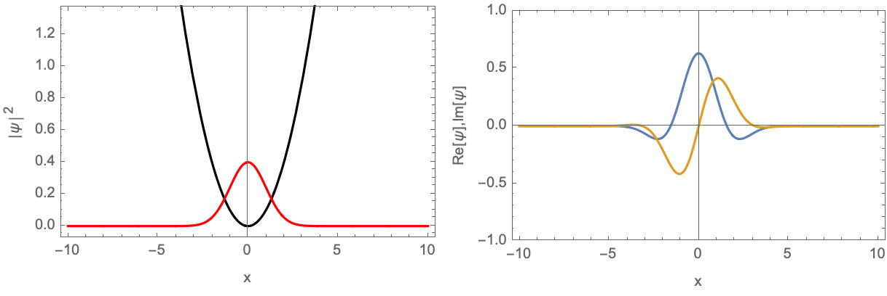
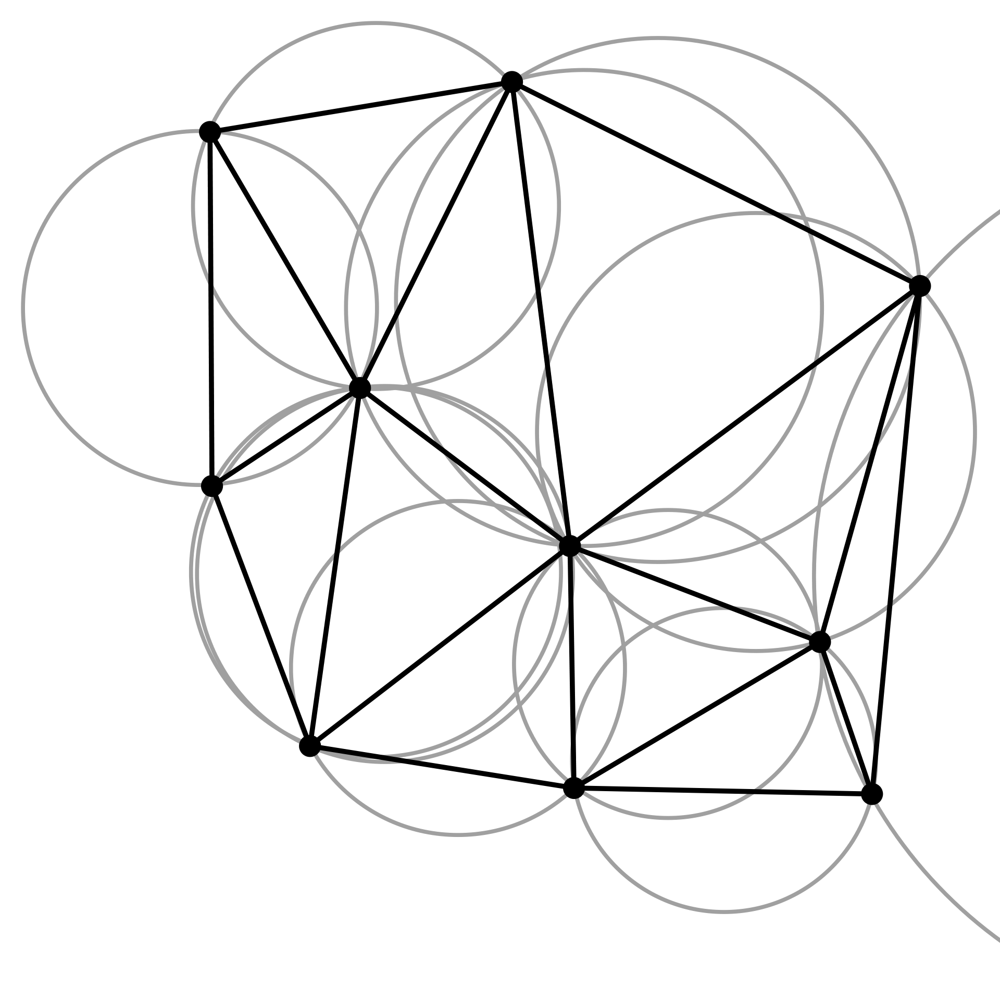
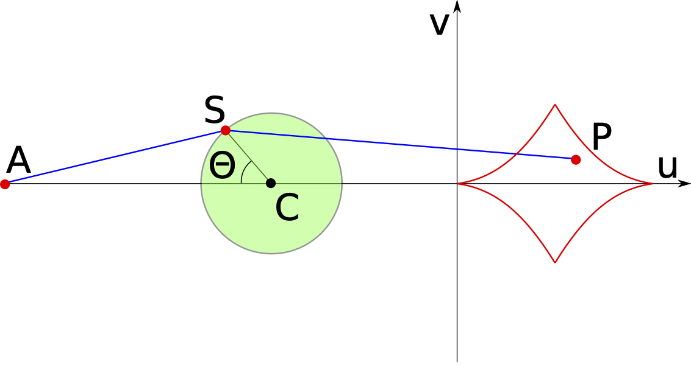
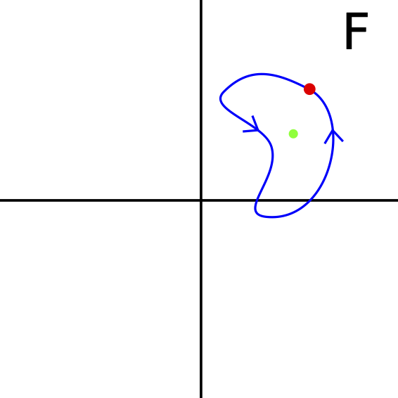
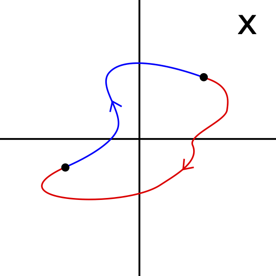
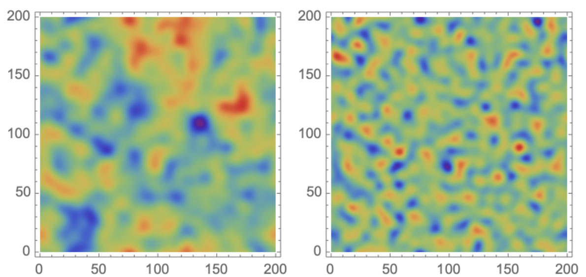
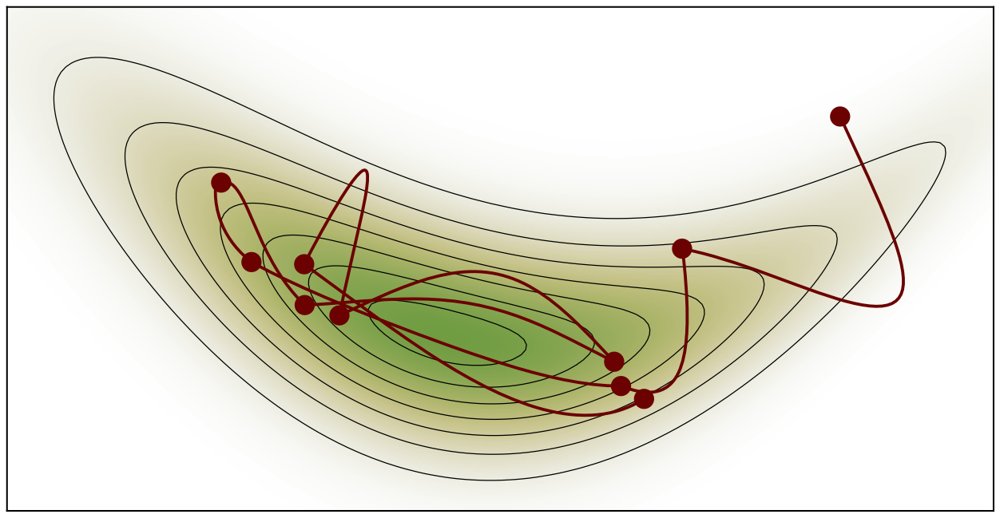
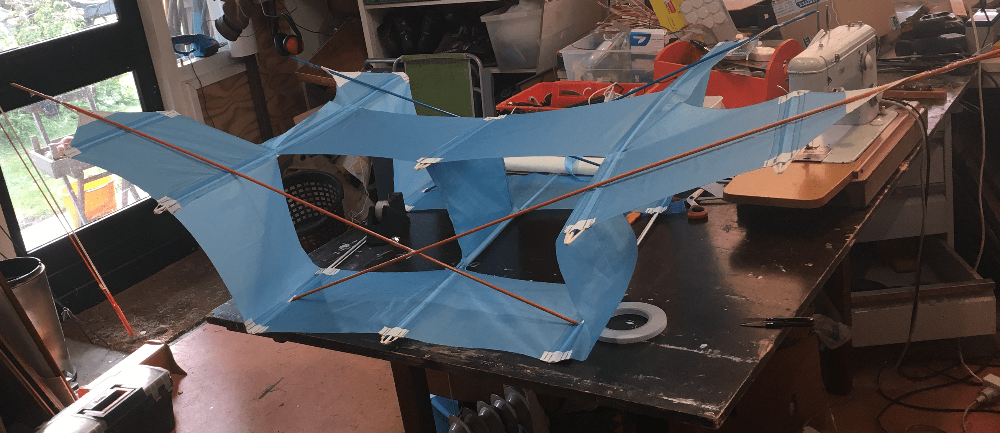

::: intro
I am a Postdoctoral Fellow at the <a href="https://lecospa.ntu.edu.tw/">Leung Center for Cosmology and Particle Astrophysics</a> at <a href="https://www.ntu.edu.tw/english/">National Taiwan University</a> and a Member of the <a href="https://www.ias.edu/">Institute for Advanced Study</a> in Princeton. I am passionate about theoretical cosmology and theoretical physics in general. For more details, see my <a href="https://jfeldbrugge.github.io/">personal website</a>. On this page, I share the documentation of a couple projects:
:::

:::::: projects

::::: project
[{alt="The evolution of a Gaussian wave packet in a harmonic oscillator"}](https://jfeldbrugge.github.io/Schrodinger/){.thumb}

::: caption
The evolution of a Gaussian wave packet in a harmonic oscillator
:::

### [Schrödinger code](https://jfeldbrugge.github.io/Schrodinger/)

Quantum mechanics is a fundamental in physics describing the evolution of non-relativistic quantum systems. In this webpage, I solve the time-dependent Schrödinger equation using the Suzuki-Trotter method. I illustrate the code with a one- and two-dimensional example.
:::::

::::: project
[{alt="A two-dimensional lens as a function of the frequency"}](https://p-lpi.github.io/){.thumb}

::: caption
A two-dimensional lens as a function of the frequency
:::

### [Picard-Lefschetz code](https://p-lpi.github.io/)

Oscillatory integrals are fundamental to physics but subtle to define and often difficult to evaluate. Using Picard-Lefschetz theory, I develop a new method to evaluate multi-dimensional oscillatory integrals. The code is demonstrated with several lensing problems in wave optics.
:::::

<!---
* <a href="https://jfeldbrugge.github.io/Caustic-Skeleton/"> Caustic skeleton</a>: The cosmic can be understood in terms of the caustics of its formation history.
-->

::::: project
[{alt="Delaunay triangulation"}](https://jfeldbrugge.github.io/DTFE/){.thumb}

::: caption
Delaunay triangulation
:::

### [DTFE](https://jfeldbrugge.github.io/DTFE/)

Delaunay Tesselation Field Estimator (DTFE) is a mathematical tool for the reconstruction of the density and velocity field of a discrete point set developed by Willem Schaap and Rien van de Weijgaert (<a href="https://www.astro.rug.nl/~weygaert/tim1publication/weyval2004.pdf">Schaap and Weijgaert 2004</a>, <a href="https://web.archive.org/web/20071210093614/http://dissertations.ub.rug.nl/faculties/science/2007/w.e.schaap/?FullItemRecord=ON">Willem Schaap 2007</a>).
:::::

::::: project
[{alt="The Zeeman catastrophe machine"}](https://jfeldbrugge.github.io/Catastrophe-Theory/){.thumb}

::: caption
The Zeeman catastrophe machine
:::

### [Catastrophe theory](https://jfeldbrugge.github.io/Catastrophe-Theory/)

Catastrophe theory is the classification of degenerate critical points. In these notes I give an impression of the mathematics underlying Catastrophe theory following <a href="https://www.routledge.com/Catastrophe-Theory-Second-Edition/Castrigiano-Hayes/p/book/9780813341255">Catastrophe Theory</a> by Domenico Castrigiano and Sandra Hayes.
:::::

::::: project
[{alt="A loop in function space"} {alt="The trajectories of the roots"}](https://jfeldbrugge.github.io/Galois-Theory/){.thumb .pair}

::: caption
The trajectories of the roots (right) under a loop in function space (left)
:::

### [Topological Galois theory](https://jfeldbrugge.github.io/Galois-Theory/)

I prove the famous unsolvability of polynomials with degree higher than $4$ using topological Galois theory. The discussion is based on an elementary proof developed Vladimir I. Arnol'd in a lecture series for high school students in 1963. For the original proof see the transcript of the lecture series <a href="https://link.springer.com/book/10.1007/1-4020-2187-9"> Abel’s Theorem in Problems and Solutions</a>. The notes are also based on the review paper by <a href="https://projecteuclid.org/journals/topological-methods-in-nonlinear-analysis/volume-16/issue-2/The-topological-proof-of-Abel-Ruffini-theorem/tmna/1471875703.full"> Henryk Żolądek </a> and the talk by <a href="https://www.youtube.com/watch?v=2eOw_TKsFXg&ab_channel=MichaelO%27Connor"> Michael O'Connor</a>.
:::::

::::: project
[{alt="Gaussian random fields: the primordial density field and gravitational potential"}](https://jfeldbrugge.github.io/Gaussian-Random-Field/){.thumb}

::: caption
Gaussian random fields: the primordial density field (right) and gravitational potential (left)
:::

### [Gaussian Random Field Theory](https://jfeldbrugge.github.io/Gaussian-Random-Field/)

I introduce a couple of key points in Gaussian random field theory and its applications to cosmology.
:::::

::::: project
[{alt="Hamiltonian Monte Carlo"}](https://jfeldbrugge.github.io/HMC/){.thumb}

::: caption
Hamiltonian Monte Carlo
:::

### [Hamiltonian Monte Carlo](https://jfeldbrugge.github.io/HMC/)

The Hamiltonian Monte Carlo method is an algorithm for sampling probability distributions that go beyond the classical distributions such as the uniform, the normal or the Poisson distribution.
:::::

::::: project
[{alt="One piece cody kite"}](https://jfeldbrugge.github.io/One-piece-Cody/){.thumb}

::: caption
One piece cody kite
:::

### [One-piece Cody kite](https://jfeldbrugge.github.io/One-piece-Cody/)

In the nineteenth century <a href="https://en.wikipedia.org/wiki/Samuel_Franklin_Cody">Samuel Franklin Cody</a> developed the *Cody War-Kites*, which were large kites able to lift persons to great hight, and were used by the British before World War I as a smaller alternative to balloons for artillery spotting. More recently, Ton Vinken developed an adaptation of the Cody kite which can be constructed out of a single piece of material. Unfortunately, it is currently difficult to find plans online. Inspired by this idea, I constructed a plan which I hope will encourage others to build the one-piece Cody kite.
:::::

::::::
